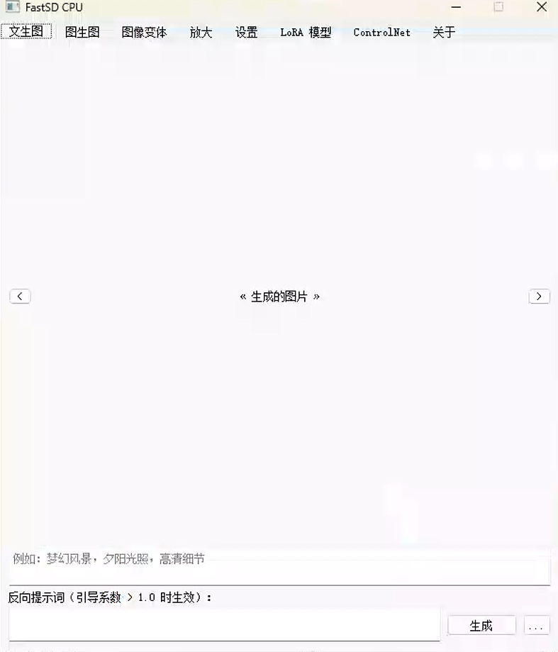
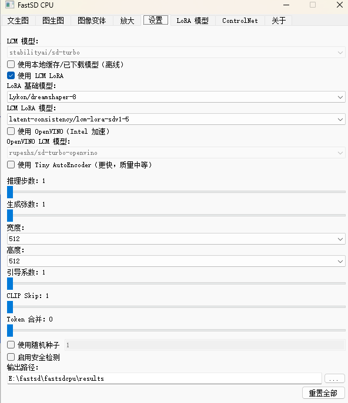
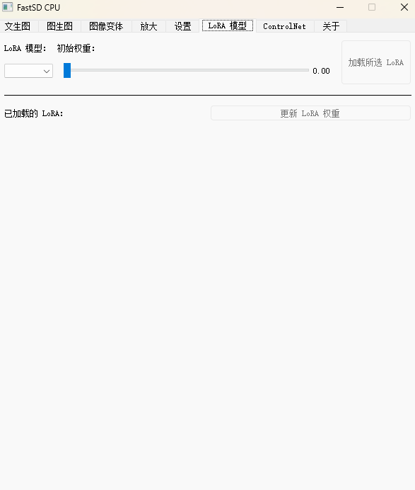
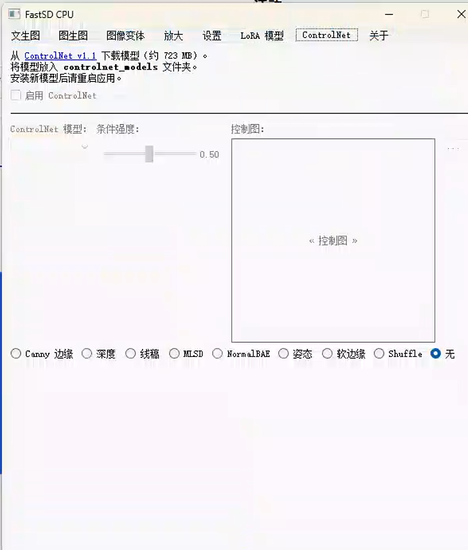
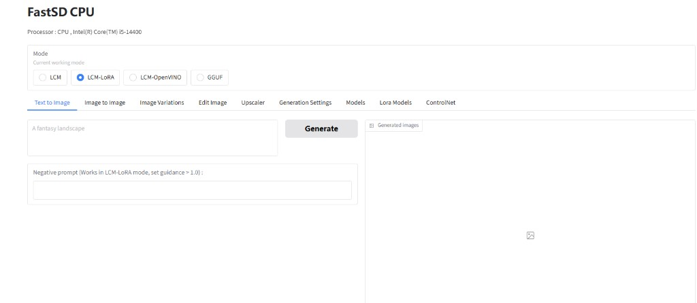

# 🎨 FastSD CPU — Fast AI Image Generation on CPU (Windows Chinese Fork)

**Languages:** [简体中文](./README.md) | **English**

Run Stable Diffusion on **CPU** with [Latent Consistency Models (LCM)](https://github.com/luosiallen/latent-consistency-model) and [OpenVINO](https://github.com/openvinotoolkit/openvino). Generate images in seconds to minutes without a discrete GPU.

This repository is based on upstream [rupeshs/fastsdcpu](https://github.com/rupeshs/fastsdcpu) with fixes for **Windows installs that fail after the official setup**, plus a **Chinese desktop GUI**. Upstream English docs remain available in the original repo; **this file covers Fork changes and full English usage notes**.

> ⭐ **If this project helps you, please give it a Star!**  
> 👉 [https://gitee.com/shenzhen-minglue/fast-sd-cpu-zh_cn](https://gitee.com/shenzhen-minglue/fast-sd-cpu-zh_cn)  
> Your star keeps an indie developer motivated ❤️

| | |
|---|---|
| Repository | [gitee.com/shenzhen-minglue/fast-sd-cpu-zh_cn](https://gitee.com/shenzhen-minglue/fast-sd-cpu-zh_cn) |
| Upstream | [github.com/rupeshs/fastsdcpu](https://github.com/rupeshs/fastsdcpu) |
| Releases | [Upstream Releases](https://github.com/rupeshs/fastsdcpu/releases) |
| License | [MIT](./LICENSE) |
| Author | abbuibuibui |
| Contact | [3244940576@qq.com](mailto:3244940576@qq.com) |

### ✨ Demo: Chinese Desktop GUI / Web UI

This Fork ships a fully localized desktop GUI. Tabs: Text-to-Image · Image-to-Image · Image Variations · Upscale · Settings · LoRA Models · ControlNet · About.

**Text-to-Image (Desktop GUI)**



**Settings (LCM / LCM-LoRA / OpenVINO, etc.)**



**LoRA Models**



**ControlNet**



**Web UI (English UI, more features; sample run on Intel i5-14400)**



---

## 📌 Features

| Feature | Description |
|------|------|
| CPU generation | No NVIDIA/AMD dGPU required; LCM / OpenVINO / GGUF modes |
| Desktop GUI | Qt UI; **Chinese localization in this Fork** (txt2img, settings, LoRA, ControlNet, …) |
| Web UI | Gradio advanced UI (English): txt2img, img2img, LoRA, settings, … |
| Multi-model | LCM, SD 1.5/SDXL bases, LCM-LoRA, OpenVINO, GGUF (Flux) |
| LoRA | Style LoRAs + LCM-LoRA adapters (up to 5 stacked) |
| ControlNet | Pose / lineart / etc. in LCM-LoRA mode |
| Fork fixes | Pinned Windows deps, install verification, torchvision in install script |

**Notes & limits:**

- ⚠️ With a strong NVIDIA GPU, prefer ComfyUI / WebUI Forge for speed; this project shines on **CPU / Intel AI PC**
- First run downloads models from Hugging Face (several GB); keep network available (China mirror tips in FAQ)
- WebUI, CLI, and `install.bat` progress text remain English; desktop GUI (`start.bat`) is Chinese

---

## 🔀 Fork vs Upstream

On Windows, following the **official install can still fail to start**: packages resolved into `env\` may not match what the project expects, causing DLL load failures or crashes.

### Typical upstream errors

| Error | Cause |
| --- | --- |
| `OSError: Error loading c10.dll` (WinError 1114) | `torch 2.13.0` installed instead of required `2.8.0` |
| Crash / access violation | `torchvision` mismatched with `torch`, or `sentencepiece 0.2.2` native crash |
| `ImportError: DLL load failed ... onnxruntime` | `onnxruntime 1.26.0` fails DLL init on some Windows setups |
| `numpy.core.multiarray failed to import` | `numpy` resolved to 2.x, incompatible with `opencv-python` |

### Declared vs broken environment (measured)

| Package | Upstream `install.bat` / `requirements.txt` | Often got in broken env | Result |
| --- | --- | --- | --- |
| **torch** | `2.8.0` | **2.13.0** | `c10.dll` load failure |
| **torchvision** | Not installed by Windows `install.bat` | **0.28.0** (pulled with torch) | Mismatch with torch 2.8 → diffusers crash |
| **sentencepiece** | Unpinned | **0.2.2** | Native DLL access violation |
| **onnxruntime** | `1.26.0` | 1.26.0 | DLL init failure on some PCs |
| **numpy** | `1.26.4` | Resolved to **2.x** | OpenCV import fails |

### Upstream install gaps

1. **`install.bat` installs `torch` but not `torchvision`** (Linux `install.sh` installs both)
2. **`requirements.txt` does not pin torch / torchvision / sentencepiece** → resolver may upgrade
3. **`onnxruntime==1.26.0` is incompatible on some Windows hosts**
4. **No post-install check** → crash only appears when running `start.bat`

### What this Fork changes

#### 1. Dependencies & install scripts (core fix)

| File | Upstream | This Fork |
| --- | --- | --- |
| `install.bat` | `torch==2.8.0` only | Also installs `torchvision==0.23.0` |
| `install.bat` | Ends after install | **Re-pins** key packages after `requirements.txt` |
| `install.bat` | No check | Ends with `Dependency check: OK` import test |
| `requirements.txt` | `onnxruntime==1.26.0` | `onnxruntime==1.19.2` (stable on Windows) |
| `requirements.txt` | No sentencepiece / protobuf pins | Adds `sentencepiece==0.2.0`, `protobuf==4.25.9` |
| `install.sh` / `install-mac.sh` | No re-pin / check | Same re-pin + verification |

**Verified Windows versions in this Fork:**

```text
torch==2.8.0+cpu
torchvision==0.23.0+cpu
numpy==1.26.4
Pillow==9.4.0
onnxruntime==1.19.2
sentencepiece==0.2.0
protobuf==4.25.9
```

#### 2. Chinese desktop GUI

| File | Change |
| --- | --- |
| New `src/frontend/i18n/` | Lightweight `tr()` + `zh_CN.py` |
| `src/frontend/gui/*.py` | Labels, buttons, settings, errors in Chinese |
| `start.bat` | Console startup messages in Chinese |

#### 3. Unchanged

- Core inference (`src/backend/`, etc.)
- Gradio WebUI
- Default model IDs / config layout
- Upstream features (LCM / OpenVINO / LoRA / ControlNet, …)

### Troubleshooting

| Situation | Action |
| --- | --- |
| `start.bat` won’t start | Delete `env\`, re-run `install.bat`, wait for `Dependency check: OK` |
| Install check fails | Verify Python 3.10/3.11 + uv; network access to PyTorch / Hugging Face |
| Manually upgraded torch in `env` | Don’t; delete `env` and reinstall |
| First generation is slow | Normal — downloads ~1–2 GB models; then cached |

---

## 🏗️ Architecture

```text
User (prompt / reference image)
      │
      ▼
┌─────────────────────────────────────┐
│  Frontends                          │
│  Desktop GUI (Qt, Chinese in Fork)  │
│  WebUI (Gradio) · CLI               │
└─────────────────────────────────────┘
      │
      ▼
┌─────────────────────────────────────┐
│  Backends                           │
│  LCM · LCM-LoRA · OpenVINO · GGUF   │
│  LoRA / ControlNet / Upscaler       │
└─────────────────────────────────────┘
      │
      ▼
┌──────────────┐     ┌──────────────────────────┐
│  results/    │     │  HF cache / local models │
│  outputs     │     │  LoRA · ControlNet       │
└──────────────┘     └──────────────────────────┘
```

**Who it’s for:**

- No NVIDIA/AMD dGPU but want local Stable Diffusion
- Intel AI PC / NPU users wanting OpenVINO
- Fast 1–3 step LCM workflows
- Style LoRAs from Civitai / Hugging Face

**Project layout (core):**

```text
fastsdcpu/
├── install.bat                 # Windows install (hardened in this Fork)
├── start.bat                   # Chinese desktop GUI
├── start-webui.bat             # Web UI
├── requirements.txt            # Pinned deps
├── results/                    # ★ default image output
├── lora_models/                # ★ LoRA (.safetensors)
├── controlnet_models/          # ★ ControlNet (.safetensors)
├── models/gguf/                # ★ GGUF assets
│   ├── diffusion/
│   ├── llm/
│   └── vae/
├── configs/
│   ├── settings.yaml           # User settings (gitignored)
│   ├── lcm-models.txt
│   ├── openvino-lcm-models.txt
│   ├── stable-diffusion-models.txt
│   └── lcm-lora-models.txt
├── env/                        # venv (gitignored; created by install.bat)
├── src/
│   ├── frontend/
│   │   ├── gui/                # Desktop GUI (localized)
│   │   ├── i18n/               # ★ Chinese strings (this Fork)
│   │   └── webui/
│   └── backend/
├── docs/images/                # README screenshots
├── LICENSE
├── README.md                   # Chinese (default on Gitee)
└── README.en.md                # English
```

---

## 🛠️ Tech Stack & Dependencies

| Layer | Tech |
|------|------|
| Language | Python 3.10+ (recommended 3.10 / 3.11) |
| Package manager | [uv](https://docs.astral.sh/uv/) |
| Inference | PyTorch CPU (pinned `2.8.0`) + Diffusers |
| Acceleration | LCM / LCM-LoRA · OpenVINO · GGUF (stable-diffusion.cpp) |
| Desktop UI | Qt (PySide) |
| Web UI | Gradio |
| Fork pins | torchvision `0.23.0` · onnxruntime `1.19.2` · sentencepiece `0.2.0` · protobuf `4.25.9` · numpy `1.26.4` |

---

## 🚀 Quick Start

### 1. Requirements

- Windows 10 / 11
- Python **3.10 or 3.11** (check **Add Python to PATH**)
- [uv](https://docs.astral.sh/uv/getting-started/installation/)
- (Recommended) **16GB+** RAM; OpenVINO / Flux need more

```powershell
python --version
uv --version
```

Install uv if needed:

```powershell
powershell -ExecutionPolicy ByPass -c "irm https://astral.sh/uv/install.ps1 | iex"
```

**Reopen the terminal** after installing uv.

### 2. Clone

```powershell
git clone https://gitee.com/shenzhen-minglue/fast-sd-cpu-zh_cn.git
cd fast-sd-cpu-zh_cn
```

### 3. Install ⚙️

Double-click **`install.bat`**, or:

```powershell
.\install.bat
```

The script will:

- Check Python / uv
- Create `env\`
- Install CPU PyTorch + torchvision and all deps
- **Re-pin** critical packages and run import checks

> Takes about 5–20 minutes. You should see **`Dependency check: OK`**.

### 4. Start 🎬

| Mode | Command | Notes |
|------|------|------|
| Desktop GUI (beginner-friendly) | Double-click `start.bat` | **Chinese UI** |
| Web UI (more features) | Double-click `start-webui.bat` | Open <http://127.0.0.1:7860> (English) |

Web UI tabs: **Text to Image** · **Image to Image** · **LoRA Models** · **Settings**, etc.

### 5. First generation 🔗

1. Start Web UI or desktop GUI
2. Pick a **Model** mode:
   - Fastest → **LCM** + e.g. `SimianLuo/LCM_Dreamshaper_v7`
   - SD 1.5 base + LoRA → **LCM-LoRA**
   - Intel CPU/NPU → **OpenVINO**
3. Prompt example:

```text
a cute corgi sitting in a meadow, golden hour, photorealistic, 8k
```

4. Optional negative prompt:

```text
blurry, low quality, deformed, extra limbs
```

5. Suggested params:
   - **Width / Height**: start at 512×512; on CPU avoid above 768×768
   - **Inference steps**: LCM 1–4; otherwise 20–25
   - **Guidance scale**: LCM usually 1.0–2.0
   - **Seed**: `-1` random, or fixed for reproducibility
6. Click **Generate**

---

## 🧩 Models & Usage

FastSD CPU centers on **LCM** (1–4 steps). Plain SD often needs 20–50 steps and is too slow on CPU without LCM / LCM-LoRA.

### Five model families

| Type | Config file | Mode | Examples |
|---------|---------|---------|------|
| **LCM models** | `configs/lcm-models.txt` | LCM | SDXS-512-0.9, SDXL-Lightning, Hyper-SD |
| **SD bases / fine-tunes** | `configs/stable-diffusion-models.txt` | **LCM-LoRA** | SD 1.5, SDXL, Civitai checkpoints |
| **LCM-LoRA adapters** | `configs/lcm-lora-models.txt` | LCM-LoRA | lcm-lora-sdv1-5, lcm-lora-sdxl |
| **OpenVINO models** | `configs/openvino-lcm-models.txt` | OpenVINO | Intel-optimized; fastest on CPU |
| **GGUF models** | `models/gguf/` | GGUF | Flux.1-schnell (~12GB RAM) |

### Key idea: base + LCM-LoRA = fast inference

```text
SD base (style / content)
        +
LCM-LoRA adapter (1–4 step speed)
        ↓
   Fast generation
```

**Three layers:**

```text
Base (SD 1.5 / SDXL)          ← style foundation
   └─ LCM-LoRA adapter         ← speed (required on CPU)
       └─ Style LoRA           ← optional (up to 5)
```

Civitai SD 1.5 / SDXL checkpoints work: add paths to `configs/stable-diffusion-models.txt`, use **LCM-LoRA** mode with a matching adapter.

### Using a Civitai SD checkpoint

1. Download a `.safetensors` file (e.g. `dreamshaper_8.safetensors`)
2. Add the full path to `configs/stable-diffusion-models.txt`:

```text
D:\models\dreamshaper_8.safetensors
```

3. Select **LCM-LoRA** mode
4. Model settings:
   - **Stable diffusion model** → your local file
   - **LCM-Lora model** → `lcm-lora-sdv1-5` for SD 1.5, `lcm-lora-sdxl` for SDXL
5. Generate as usual

You can also list Hugging Face IDs (e.g. `Lykon/dreamshaper-8`) for auto-download.

### Recommended combos

| Goal | Base | LCM-LoRA adapter | Steps |
|------|------|---------------|------|
| Fastest (1 step) | `runwayml/stable-diffusion-v1-5` | `rupeshs/hypersd-sd1-5-1-step-lora` | 1 |
| Anime | `stablediffusionapi/anything-v5` | `lcm-lora-sdv1-5` | 3–4 |
| Photoreal | `Lykon/dreamshaper-8` | `lcm-lora-sdv1-5` | 3–4 |
| SDXL | `stabilityai/stable-diffusion-xl-base-1.0` | `lcm-lora-sdxl` | 2–4 |
| Intel max speed | OpenVINO: `rupeshs/sd-turbo-openvino` | — | 1 |

### Mode cheat sheet

| Mode | Speed | Best for | Notes |
|------|------|------|------|
| **LCM** | Very fast (1–4 steps) | Fastest images | Needs LCM models |
| **LCM-LoRA** | Very fast | SD 1.5/SDXL + LoRA | Negative prompts; **use for Civitai checkpoints** |
| **OpenVINO** | Fastest on Intel CPU | Intel platforms | **No LoRA** |
| **GGUF** | Medium | Flux, etc. | Via stable-diffusion.cpp |

---

## 🎭 Style LoRAs

| Type | Purpose | Mode |
|------|------|------|
| **Style LoRA** | Civitai/HF style adapters | LCM or LCM-LoRA |
| **LCM-LoRA** | Makes plain SD run in 1–4 steps | LCM-LoRA |

### 1. Download & place

- [Civitai](https://civitai.com/) · [Hugging Face](https://huggingface.co/)
- Put `.safetensors` under **`lora_models/`** (subfolders OK; recursive scan)

```text
fastsdcpu/
└── lora_models/
    ├── my_style.safetensors
    └── anime/
        └── anime_style.safetensors
```

### 2. Web UI

1. Switch to **LCM-LoRA**
2. Pick base + LCM-LoRA adapter
3. **LoRA Models** tab: select file → weight (often 0.6–0.9) → Load
4. Generate (up to **5** LoRAs)

### 3. CLI example

```powershell
.\src\frontend\cli.py --base_model_id runwayml/stable-diffusion-v1-5 `
    --use_lcm_lora `
    --lora_path lora_models/my_style.safetensors `
    --lora_weight 0.8 `
    --prompt "a cute corgi, photorealistic" `
    --inference_steps 4 `
    --guidance_scale 1.5
```

| Flag | Meaning |
|------|------|
| `--use_lcm_lora` | Enable LCM-LoRA |
| `--use_openvino` | Enable OpenVINO |
| `--lora_path` / `--lora_weight` | LoRA path & weight 0.0–1.0 |
| `--prompt` / `--negative_prompt` | Prompts |
| `--image_height` / `--image_width` | Resolution |
| `--inference_steps` | Steps (LCM 1–4) |
| `--guidance_scale` | Guidance |
| `--seed` | Seed |

Offline LCM-LoRA: add local folder paths to `configs/lcm-lora-models.txt`, restart, then select in the dropdown.

---

## 📁 Paths & Files

### Where are generated images?

| Item | Notes |
| --- | --- |
| **Default output** | `results\` |
| **Change path** | Desktop GUI → **Settings** → **Output path** |
| **Config** | `configs/settings.yaml` → `generated_images.path` |

| File | Notes |
| --- | --- |
| `{id}-1.png` | Image (`-2.png`, … for batches) |
| `{id}.json` | Generation params |
| `{name}_2x_upscale_{ts}.png` | Upscale output (still under `results\`) |

Default format is **PNG** (`generated_images.format` in `settings.yaml`).

### Where do models go?

Weights are **not** shipped. Main models auto-download to `%USERPROFILE%\.cache\huggingface\hub\` on first use. Extra assets must be placed manually:

| Type | Path | Format |
| --- | --- | --- |
| LCM / OpenVINO mains | Auto | First generation downloads |
| LoRA | `lora_models\` | `.safetensors` |
| ControlNet | `controlnet_models\` | `.safetensors` (**restart** after adding) |
| GGUF diffusion / LLM / VAE | `models\gguf\diffusion\` · `llm\` · `vae\` | `.gguf` / `.safetensors` |

ControlNet reference: [ControlNet v1.1 fp16](https://huggingface.co/comfyanonymous/ControlNet-v1-1_fp16_safetensors/tree/main) (~723 MB).

List configs under `configs\` (one HF ID or absolute path per line):

| File | Purpose |
| --- | --- |
| `lcm-models.txt` | LCM mains |
| `openvino-lcm-models.txt` | OpenVINO models |
| `stable-diffusion-models.txt` | LCM-LoRA bases (incl. Civitai paths) |
| `lcm-lora-models.txt` | LCM-LoRA adapters |

Offline: enable “use local cache / downloaded models” in Settings and write paths into those `.txt` files.

---

## ❓ FAQ

**Q: `python not found`?**  
A: Reinstall Python with Add to PATH, or add Python to system PATH manually.

**Q: Model download stuck / slow?**  
A: In China, set a Hugging Face mirror before starting:

```powershell
$env:HF_ENDPOINT="https://hf-mirror.com"
.\start-webui.bat
```

**Q: LoRA has no effect?**  
A: ① Use **LCM or LCM-LoRA** (OpenVINO has no LoRA); ② raise weight to 0.8–1.0; ③ match base architecture (SD 1.5 LoRA ≠ SDXL).

**Q: Generation is slow?**  
A: Use LCM, 2–4 steps, 512×512; on Intel try OpenVINO; close other CPU-heavy apps.

**Q: Out of memory?**  
A: Lower resolution or use GGUF quantized models.

**Q: `start.bat` still fails?**  
A: Delete `env\`, re-run `install.bat`, confirm `Dependency check: OK`; don’t manually upgrade packages inside `env`.

---

## 🔗 References

- Upstream: <https://github.com/rupeshs/fastsdcpu>
- Releases: <https://github.com/rupeshs/fastsdcpu/releases>
- LoRA / models: <https://civitai.com/> · <https://huggingface.co/>
- uv: <https://docs.astral.sh/uv/getting-started/installation/>
- Upstream docs (EN): <https://deepwiki.com/rupeshs/fastsdcpu>

---

## 💬 Feedback & Contributing

If this project helps you:

1. ⭐ Star the repo: [fast-sd-cpu-zh_cn](https://gitee.com/shenzhen-minglue/fast-sd-cpu-zh_cn)
2. 🐛 Open an [Issue](https://gitee.com/shenzhen-minglue/fast-sd-cpu-zh_cn/issues) (include Windows version, Python version, full traceback)
3. ✉️ Email: [3244940576@qq.com](mailto:3244940576@qq.com) (author: abbuibuibui)

Pull Requests are welcome — please describe the change and how you tested it.

Upstream author & maintainer: [Rupesh Sreeraman](https://github.com/rupeshs). This Fork only adds Windows dependency fixes and a Chinese GUI on top.

---

## 📄 License

Released under the [MIT License](./LICENSE) (same as upstream).

```text
Copyright (c) 2026 abbuibuibui
```

When using third-party models and data sources, follow their terms. This project is for learning and research only and makes no guarantees about generated content. Users must comply with local laws and use the tool responsibly.
